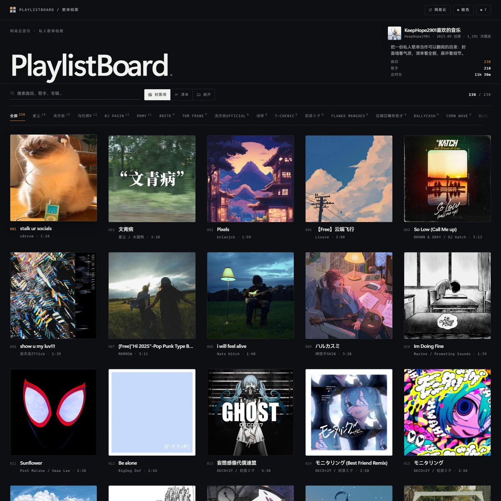
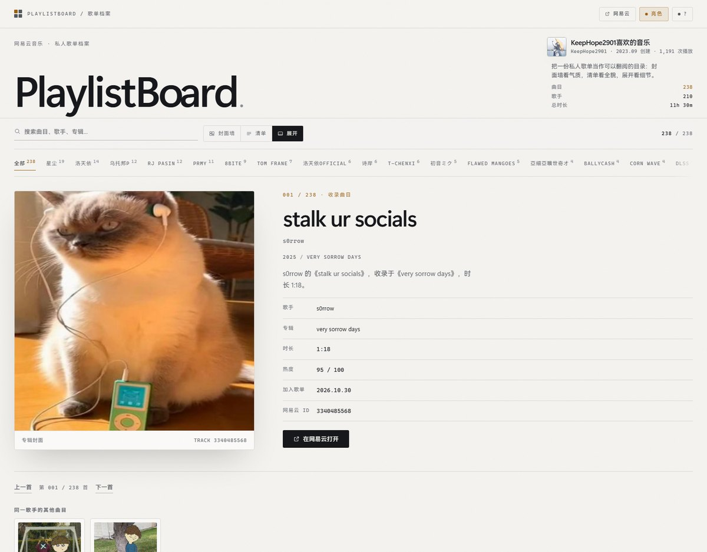

# PlaylistBoard 歌单档案

把一份网易云歌单，做成一份**可以翻阅的目录**，而不是一面播放器卡片墙。
同一批曲目给了三种读法：**封面墙**看气质，**清单**看全貌，**展开**看细节。
全键盘可操作，明暗双主题，**零依赖、无构建，双击 `index.html` 就能看**。


---

当前配置抓取的是网易云歌单 **《KeepHope2901喜欢的音乐》**（ID `8765669532`）：

| 项目 | 数值 |
| --- | --- |
| 曲目 | 238 首 |
| 署名歌手 | 210 位 |
| 专辑 | 231 张 |
| 总时长 | 11 小时 30 分 |
| 数据抓取 | 2026.10.30 |

页面上的歌名、歌手、专辑、时长、热度、加入歌单时间和封面，全部来自构建时抓取的
网易云公开数据；页面运行时不发起任何网络请求。

## 预览





## 三种视图

| 视图 | 快捷键 | 用途 |
| --- | --- | --- |
| **封面墙** | `1` | 5 列方形专辑封面。所有砖同宽同高，一眼扫完整张歌单 |
| **清单** | `2` | 高密度目录表：编号 / 封面 / 曲目 / 歌手 / 专辑 / 时长 |
| **展开** | `3` | 单曲大开面：方形封面 + 规格表 + 同歌手其他曲目 |

三种视图共享同一个“当前选中”，切换视图不会丢掉你正在看的那一首。

## 快速开始

```bash
# 直接双击 index.html 即可
```

想换成自己的歌单：

```bash
# 1. 编辑 playlist.config.json，把 playlistId 换成目标歌单的数字 ID
#    也可以直接粘贴链接：https://music.163.com/#/playlist?id=8765669532
# 2. 重新抓取元信息与封面，生成 js/playlist.js
node tools/build-playlist.mjs
```

需要 Node 18 以上（用到内置 `fetch`），不需要 `npm install`。

常用参数：

```bash
node tools/build-playlist.mjs --limit 40   # 只取前 40 首，快速预览
node tools/build-playlist.mjs --force      # 忽略已下载的封面，全部重抓
node tools/build-playlist.mjs --help
```

## 它是怎么抓的

只读公开接口，不需要登录、Cookie 或任何账号：

| 数据 | 来源 |
| --- | --- |
| 歌单元信息（名称、创建者、播放数、封面、创建时间） | `music.163.com/api/v6/playlist/detail` |
| 全部曲目 ID | 同一响应里的 `playlist.trackIds` |
| 曲目资料（歌名、歌手、专辑、时长、热度、发行时间） | `music.163.com/api/v3/song/detail`，每 50 首一批 |
| 封面图 | 网易云图片 CDN，通过 `?param=400y400` / `?param=640y640` 取缩放图，不下载原图 |

构建脚本不依赖内联的 `tracks`，而是拿全量 `trackIds`，
再用 `v3/song/detail` 分批补齐。脚本跑完会核对实际可读取数量与歌单标注数量，
不一致时会在命令行里明确提示。

封面会被缓存到 `assets/covers/`：重新构建时已存在的封面直接复用，只补新增的专辑。
某张封面抓不到时会生成同尺寸 SVG 占位图，页面不会出现碎图或空洞。

## 页面特性

- **全键盘操作**：`/` 搜索，`1` `2` `3` 切视图，`J` `K` 移动，`Shift + J/K` 一次跳 10 首，
  `Home` / `End` 跳到首尾，`Enter` 展开，`Esc` 返回列表，`L` 切明暗，`G` 回顶部，`?` 快捷键面板。
- **明暗双主题**：默认暗色，可跟随系统、手动覆盖并记住选择；首屏前用内联脚本定好主题，不闪白。
- **搜索与筛选**：按曲目、别名、歌手、专辑、年份、网易云 ID 搜索；按“常听歌手”横向筛选。
- **零依赖**：没有 CDN、没有图标库、没有构建步骤；字体只用系统已安装的字族。
- **可访问性**：跳转链接、焦点环、`aria-current` / `aria-selected` / `aria-pressed`、
  表格语义、`prefers-reduced-motion`、`prefers-contrast`。
- **响应式**：桌面 5 列、平板 3 列、手机 2 列；左右安全边距桌面 32px、窄屏 20px，
  封面网格与上方标题区严格同宽；清单在窄屏收起歌手与专辑列。
- **氛围背景**：歌单封面模糊 60px 后作为整页底色，上面压一层随主题变化的渐变遮罩，保证文字对比度。
- **悬浮反馈**：鼠标移到顶栏控件、视图切换、歌手筛选栏、歌曲方块、清单行和关联曲目时，
  统一铺一层半透明琥珀底色；方块是封面上的 13% 琥珀叠加，不再用黄色描边。
- **数据兜底**：封面失败显示文字占位块；数据文件缺失时显示“数据未就绪”并给出构建命令。

## URL 参数

| 参数 | 取值 | 说明 |
| --- | --- | --- |
| `view` | `wall` / `index` / `spread` | 直接打开某个视图 |
| `theme` | `dark` / `light` | 强制主题 |
| `q` | 任意关键词 | 预填搜索并过滤 |
| `artist` | 歌手名 | 预选歌手筛选 |
| `track` | 曲目 ID | 打开某首歌（默认进入展开视图） |
| `motion` | `off` | 跳过入场动画，页面一次性全部可见 |
| `kbd` | `1` | 打开时展开快捷键面板 |

例如：`index.html?view=spread&track=2122477024&theme=light`

## 项目结构

```
PlaylistBoard/
├── index.html              页面结构（导航 / 英雄区 / 工具栏 / 三种视图 / 页脚）
├── favicon.svg             站点图标
├── playlist.config.json    ★ 歌单配置，换歌单改这里
├── css/
│   ├── tokens.css          设计令牌：颜色 / 字体 / 字阶 / 间距 / 圆角 / 动效 / 层级
│   ├── base.css            重置、排版基线、可访问性、动效偏好
│   └── layout.css          外壳与全部组件样式
├── js/
│   ├── app.js              渲染与交互（普通脚本，非 ES Module）
│   └── playlist.js         生成的歌单数据，请勿手改
├── assets/covers/          封面图（专辑 400×400，歌单 640×640）
├── docs/                   README 预览图
└── tools/
    ├── build-playlist.mjs  读配置 → 抓歌单与曲目 → 下载封面 → 写出 js/playlist.js
    ├── probe.mjs           用真实浏览器做几何 / 交互体检
    └── shoot.mjs           批量截图：三视图 × 两主题 × 窄屏
```


## 数据与版权

- 歌单、曲目、歌手等文字资料与封面图的版权归网易云音乐及各自权利人所有，
  **不在本项目的 MIT 协议范围内**（详见 [LICENSE](LICENSE)）。
- 本项目只抓取公开可读的歌单；不涉及登录、账号、私人数据。
- 网易云 API 不是官方公开 API，接口字段与可用性可能变化；如遇失败，先确认歌单是公开的，
  再检查 `node tools/build-playlist.mjs` 的输出。
- 页面是构建时快照：歌单更新后需要重新运行构建脚本，页面不会自动同步。
- 部分曲目在 API 中缺少发行时间，因此展开视图不展示“发行日期”，只展示专辑、时长、
  热度、加入歌单时间与网易云 ID；这些字段在抓取时是什么就展示什么，不做推测。

## 部署

纯静态。仓库根目录就是站点根目录，已包含 `.nojekyll`（GitHub Pages 会跳过 Jekyll，直接按静态文件发布）。
推到 GitHub 后：**Settings → Pages → Deploy from a branch**，分支选 `main`，目录选 `/ (root)`。

如果只部署页面而不带 `assets/covers/`，所有封面会显示文字占位块，页面仍然可用。

## License

代码与文档：MIT。第三方封面与文字资料：见 [LICENSE](LICENSE) 的“关于第三方素材”。
